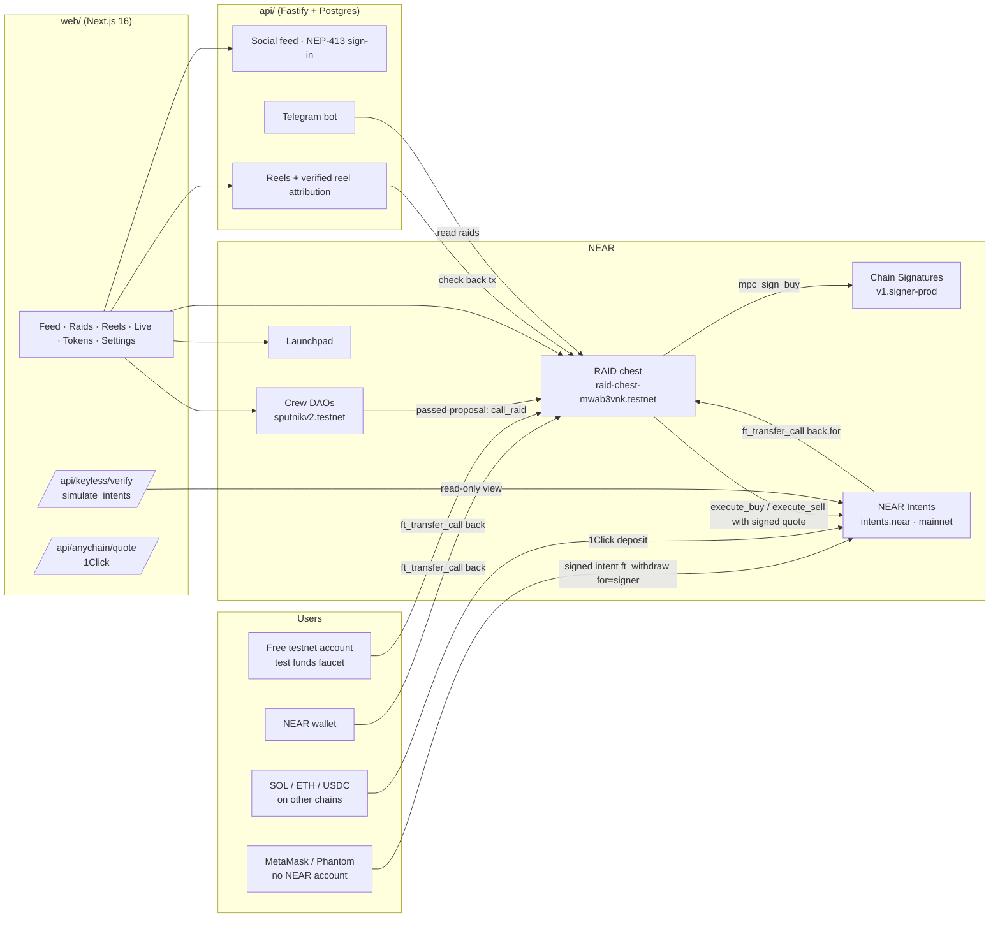

# RAID

**Call a raid on any memecoin. Your crew backs it. A keyless war chest on NEAR buys together and can only sell at the line.**

- **Live app (NEAR testnet):** [https://raid-near.vercel.app](https://raid-near.vercel.app)
- **A full raid, start to payout, on testnet:** [https://raid-near.vercel.app/raids/1](https://raid-near.vercel.app/raids/1)
- **Landing page:** [https://raid.5-189-170-85.sslip.io](https://raid.5-189-170-85.sslip.io)

> NEAR HACKATHON, Nov 2026. Tracks: `memecoins` (primary), `defi`, `open`, `social` (crews are Sputnik DAOs).
> Status: **NEAR testnet**. Nothing is deployed to mainnet and no real funds are used. Every number below links to a testnet transaction. One raid has gone the whole way on testnet: Open, Bought, Held, Sold at the line, Closed, every backer and the caller paid (raid #1 below). A second raid missed the line after retreat, sold at market, paid no fees, and returned what came back to the backer (raid #2 below).
> Baseline disclosure (Q-003/Q-004): the social app shell comes from the team's earlier project *Called* (`docs/REUSE-MAP.md`).
> Everything else is new in the window: the chest and launchpad contracts, raids, Raid War, crews, reels, keyless backing, the test funds faucet and the Telegram bot.

## The problem
Meme "raids" happen in Telegram and X every day. Someone shouts "PEPE to 2x", people pile in, and insiders dump on the crowd.
Nobody can see who bought, when, or whether the caller sold first, and the caller wins either way.

## How RAID works
1. **Call.** Anyone, or a crew DAO by vote, calls a raid: a coin on any chain (PEPE on Ethereum, DOGE, TRUMP on Solana, NEAR tokens), a line (1.5x, 2x or 3x) and a retreat deadline.
2. **Back.** The crew backs it with USDC during the crew window. You can back from a NEAR wallet, from MetaMask or Phantom with **no NEAR account** (NEAR Intents signed intents), or from SOL, ETH or USDC on other chains through 1Click deposit addresses.
3. **Public countdown.** After the window, a 10-minute public countdown runs. The target and the buy time are on chain, so nobody gets a surprise buy.
4. **Buy together.** The chest buys the whole pot in one swap through **NEAR Intents**. It refuses any swap without a quote signed by 1Click that it checks on chain. Alternatively, it signs its own intent with **Chain Signatures**; no human key exists.
5. **Sell at the line, or retreat.** The chest can only sell at ≥ entry × line, or at market after the retreat deadline.
6. **Split.** On a hit, fees come only out of **profit**: 2.5% to the caller and 7.5% to a buyback reserve. Backers keep the stake plus 90% of the profit. On a miss nobody takes a fee, and the caller earns nothing.

| Line | Back 100, line hits | Net | Line misses |
|---|---|---|---|
| 1.5x | 145.00 | +45% | 0 – 100 |
| 2x | 190.00 | +90% | 0 – 100 |
| 3x | 280.00 | +180% | 0 – 100 |

It is a game with rules enforced by a contract, not an investment product.

### Around the raid
- **Raid War** (`/war`): two crews compete for 24 hours. Firepower is USDC backed into their DAO-called raids; hits are realised multiples. A share card is rendered at `/api/war/card`.
- **Crews are Sputnik DAOs** (`sputnikv2.testnet`): a raid is a `FunctionCall` proposal to `call_raid`. When it passes, **the DAO itself is the caller**, so the caller fee goes to the crew treasury.
- **Reels** (`/reels`): a vertical video feed that markets raids. Upload an mp4 of up to 60 s, or paste an X, Instagram or TikTok link. Each reel shows the coin, the live raid phase and a Back button. A back through a reel is verified on chain and credits the creator 20% of the caller's fee on a hit (*off-chain attribution, not yet on the contract*). `/reels/top` ranks creators.
- **Launchpad** (`/launch`): bonding-curve coins priced in USDC, with a 1% creator fee. It also shows live fair launches from meme.cooking (read-only).
- **Social:** a feed and crew chat on every raid, with NEP-413 sign-in (no gas).
- **Telegram bot:** `/raid PEPE 2x` posts a countdown card with a Back button. It edits the card as the crew fills and announces the hit or retreat (code and mock tests; not run live).

## Built with NEAR partners
| Partner | What RAID uses it for | Where |
|---|---|---|
| **NEAR Intents** (1Click + `intents.near`) | The chest's buy and sell swaps, checked against a 1Click-signed quote; any-chain deposits; MetaMask (ERC-191) and Phantom (raw Ed25519) signed backs with no NEAR account; payouts into an intents account (`claim_into_intents`) | `contracts/raid-chest/src/lib.rs` (`execute_buy`, `check_quote`, `ft_on_transfer` `for`), `web/src/lib/keyless.ts`, `docs/ANYCHAIN.md` |
| **Chain Signatures** (`v1.signer-prod.testnet`) | The chest derives its own key and signs its own `token_diff` buy intent (`mpc_sign_buy`); no keeper key | `contracts/raid-chest/src/lib.rs` (`mpc_*`), `docs/KEYLESS-FEASIBILITY.md` |
| **Sputnik DAO v2** (`sputnikv2.testnet`) | Crew treasuries; raids are DAO proposals that call the chest when they pass; Raid War scores DAOs | `scripts/crews.mjs`, `web/src/lib/crews.ts`, `web/src/app/war` |
| **meme.cooking** | Read-only list of live NEAR fair launches on `/launch` | `web/src/app/api/market/launches/route.ts` |

Not used: Rhea, HOT, HEX, Aurora and Trezu. We don't claim them.

## Architecture

## Try it with no money
Everything runs on NEAR testnet. No wallet install and no real money.
1. Open [https://raid-near.vercel.app](https://raid-near.vercel.app), tap **Sign in** at the top right, then **New here? Get a free testnet account**. Your browser makes a new key; only the public key goes to the test funds faucet (`web/src/app/api/faucet/route.ts`), which opens a `u-….raidapp.testnet` account with test NEAR and sends it 500 test USDC. You see "Signed in as u-…". The key stays in your browser's localStorage. Already have a testnet wallet? Use **Connect a NEAR wallet**, then **Settings → Get test funds → Claim test funds** (once a day).
2. Open [https://raid-near.vercel.app/raids/1](https://raid-near.vercel.app/raids/1). You see a raid that hit its goal: the chest's buy and its sale at 2.05x, the fee split, and a list of every testnet transaction for it.
3. Open the **Raid** tab, pick a coin, tap **Start a raid**, choose a goal (1.5x, 2x or 3x) and confirm. On this testnet chest the join window and the public countdown are 1 minute each. Your raid appears in the list with its receipt.
4. Open any open raid and tap **Join raid** with 10 test USDC. You see your account in the raid's backer list (`get_backers` on the chest). The raid page also shows what 10 in pays back if the coin hits the goal, after fees.

Every page is readable without signing in.

## Evidence (NEAR testnet)
### Full raid lifecycle on testnet (raid #1)
Script: `scripts/testnet-lifecycle.mjs`. Log with every step, result and tx: `evidence/testnet-lifecycle-run.json`. The same tx list shows on [https://raid-near.vercel.app/raids/1](https://raid-near.vercel.app/raids/1).

NEAR Intents and 1Click run on mainnet only, so this run uses a fresh chest (`raidchest-mwgr1bk0.testnet`) whose `intents` account is **`contracts/intents-sim`** (`raidvenue-mwgr1iba.testnet`): a small testnet contract with the same methods the chest calls on `intents.near` (`ft_on_transfer`, `mt_transfer`, `mt_balance_of`, `ft_withdraw`, `add_public_key`). The chest's 1Click key is a testnet quote signer. A solver account (`raidsolver-mwgr1iba.testnet`) plays the 1Click market maker and the bridge: it receives the pot at its deposit account and pays the coin back, and later buys the coin back for tUSDC. **The solver sets the prices (1 tPEPE = 1 tUSDC at entry, 2.05 tUSDC at exit), so the price move is simulated.** The chest code, quote checks, countdown, line rule, fee split and claims are the same contract that is meant for mainnet. The target coin is `tPEPE` (`raidpepe-mwgr1iba.testnet`), a testnet NEP-141.

Result: 120 tUSDC in, 246 tUSDC out. Profit 126. Caller (the crew DAO) 3.15 (2.5% of profit), buyback reserve 9.45 (7.5%), backers 233.40 pro rata.

| Step | Tx (NearBlocks testnet) |
|---|---|
| Crew DAO proposes `call_raid` (raid #1) | [`GGiw91WZCc…`](https://testnet.nearblocks.io/txns/GGiw91WZCcLEGWTfbMELAuf7QvQJEYqKXyxfYUFVXof7) |
| Second vote passes, the DAO calls raid #1 | [`3u2Pq3Xo2M…`](https://testnet.nearblocks.io/txns/3u2Pq3Xo2MxMHPJN1XovnG8Pz4ZfT4Ryhb6cppHdfwiH) |
| Back from a NEAR wallet, 40 tUSDC | [`926u4adPKp…`](https://testnet.nearblocks.io/txns/926u4adPKprVd8usCwVB41RSXQTNBHfqDG6JubvvavTw) |
| Back from a NEAR wallet, 60 tUSDC | [`A1KD7xXLaa…`](https://testnet.nearblocks.io/txns/A1KD7xXLaaNc98XcRr5DVDPkvqVHUQeT5dhuzLaS3Krf) |
| Any-chain back for an EVM (`0x…`) account, 12 tUSDC | [`4v9ENX4evP…`](https://testnet.nearblocks.io/txns/4v9ENX4evPEweLBfwZZvJS3vaoGXmGcujQGTEWDACNpQ) |
| Any-chain back for a Solana-style ed25519 account, 8 tUSDC | [`EEVbKKCpbx…`](https://testnet.nearblocks.io/txns/EEVbKKCpbxKyL1cU598HtxNRKtEL5Bk5EQvM8Bhv2yc1) |
| Buy during the public countdown: refused by the contract | [`6uiyrF13uk…`](https://testnet.nearblocks.io/txns/6uiyrF13ukVV5pwMjTiQ6Ey5tRQtiVXXZ9C2skT8h1MG) |
| Chain Signatures: the chest derives its key, then signs its own buy intent for the pot | [`9LzUM7eL39…`](https://testnet.nearblocks.io/txns/9LzUM7eL39xS4ERqnhkJBwC5Sn2Lb2vW7eQUD8Rw4UKr) / [`6NwhdgXto9…`](https://testnet.nearblocks.io/txns/6NwhdgXto9XCY8UHzFek9PTB5i9GPUqBvMsFdmE85S25) |
| Buy with a quote whose signature does not match: refused | [`3e1PB5Cnsj…`](https://testnet.nearblocks.io/txns/3e1PB5CnsjeRoa3po875qWcwVTbEGUMrtedS1HRXpYeA) |
| `execute_buy`: signed quote checked on chain, 120 tUSDC pot sent to the solver | [`8vyn1cobJW…`](https://testnet.nearblocks.io/txns/8vyn1cobJW5XnTWipsnVDguhNptLWmpv9QY2Bc4RnDeH) |
| Solver delivers 120 tPEPE; `settle`: Buying to Held | [`FkriFSmyHZ…`](https://testnet.nearblocks.io/txns/FkriFSmyHZd1JxNj1vuYFQCa55wFp5CVxFsg19Hf3mHN) / [`6vbQR9VHE8…`](https://testnet.nearblocks.io/txns/6vbQR9VHE8WSLW2kSZneFsA8dp4iGKJSyKvjYHBbFh6d) |
| Sell below the 2x line before the retreat deadline: refused | [`2fiYC5wgbz…`](https://testnet.nearblocks.io/txns/2fiYC5wgbzWrgkwRooQb5BwB72zqEtT4NMkdseTdrN1Z) |
| `execute_sell` at the line (quote min out at least 2x entry) | [`H7DsY6BADv…`](https://testnet.nearblocks.io/txns/H7DsY6BADvKxqgVDc2aWQKYnK2w7psTE5usB9sgGxQKe) |
| Solver pays 246 tUSDC; `settle`: Selling to Closed, hit, fees split | [`26bNN6MzfY…`](https://testnet.nearblocks.io/txns/26bNN6MzfY7yFvWSX8kNpVG8nUUKAT12njhkuwJpabuY) / [`9sBPwXS8mY…`](https://testnet.nearblocks.io/txns/9sBPwXS8mYkj1HM2mgojvrcUChuecNSFknEumtfrbpvn) |
| Backer 1 claims 77.80 tUSDC to the wallet (staked 40) | [`8kgEN3TVqc…`](https://testnet.nearblocks.io/txns/8kgEN3TVqc6uw2SEGYmW8knAFtxyvEUa47ySrXhYhXhw) |
| Backer 2 claims 116.70 tUSDC (staked 60) | [`ELDuyT3ygU…`](https://testnet.nearblocks.io/txns/ELDuyT3ygU83vHrWKcxi2fFpxiWo8YGm7nzVHPaduKAF) |
| EVM and Solana-style backers paid into their own accounts (23.34 and 15.56 tUSDC) | [`4SQyjpdMT5…`](https://testnet.nearblocks.io/txns/4SQyjpdMT5iY4A5kcB1nSrPgNnxnHNi5tm2myN81ryVa) / [`5dwWAmaUnq…`](https://testnet.nearblocks.io/txns/5dwWAmaUnqhV9pZr5zUE99ZCnnkCstiWdcXHK9mgKCLu) |
| Crew DAO votes to claim its 3.15 tUSDC caller fee into the crew treasury | [`E7UXmuFB22…`](https://testnet.nearblocks.io/txns/E7UXmuFB22hhqnoTc3pWrFwoam2MuStw4TEWDCLkk2M) |

### Miss path on testnet (raid #2)
Same script, later steps: `node testnet-lifecycle.mjs retreat-a`, then `retreat-b` after the 1 hour deadline. Log: `evidence/testnet-lifecycle-run.json`. Receipt list: `evidence/lifecycle-receipts.json`.

Raid #2 was called directly by `raidcaller-mwgr1iba.testnet` with a 3x line and a 1 hour retreat. backer2 staked 20 tUSDC. The chest bought and held. After the retreat deadline it sold at market at 0.7x (the solver set that price, on the same Intents stand-in as raid #1). Result: 20 tUSDC in, 14 tUSDC out. `hit` is false. Caller fee 0, buyback 0, `for_backers` 14.00. The backer claimed 14.00 tUSDC. No fees were taken on the miss.

| Step | Tx (NearBlocks testnet) |
|---|---|
| Raid #2 called (3x line, 1 h retreat) | [`2x1vabeLnE…`](https://testnet.nearblocks.io/txns/2x1vabeLnEx5kzmuUoYgeQ9V1f1hd8VqwrAWNv1RNkQS) |
| Backer 2 backs 20 tUSDC | [`7mN9aKXCrL…`](https://testnet.nearblocks.io/txns/7mN9aKXCrLiVYdUfUo2afWcEG6zyK6AtmrZkA4cPHcYJ) |
| `execute_buy` | [`3Y47rc4LH6…`](https://testnet.nearblocks.io/txns/3Y47rc4LH6618UtcRDy9CGqTpNNn8F6zSTEsHYyWPoUZ) |
| Solver delivers 20 tPEPE; `settle`: Held | [`8pihWe91HP…`](https://testnet.nearblocks.io/txns/8pihWe91HPdAbaDVbq7oH71ptHuMKERTurec4bEwMvdk) / [`6Uj76G8SW2…`](https://testnet.nearblocks.io/txns/6Uj76G8SW2dyJ3DzmS68T6gPAJ4J6EfpNH2vjib7EpLx) |
| After retreat, `execute_sell` at market (0.7x) | [`JBECpgPFy5…`](https://testnet.nearblocks.io/txns/JBECpgPFy5cn7Yv1nL8xmVyvjBphRfngUBfN48NDdNV2) |
| Solver pays 14 tUSDC; `settle`: Closed, miss, no fees | [`Czq9P7oA27…`](https://testnet.nearblocks.io/txns/Czq9P7oA272av1rwLHWNYzxRyxBrNiNc85hbCcS58yWX) / [`Fk2k5zgfNK…`](https://testnet.nearblocks.io/txns/Fk2k5zgfNKGc1bDVTUmSueZAqG73Vm2jTBi7pBLhSLGP) |
| Backer 2 claims 14.00 tUSDC (staked 20) | [`HxA7yWXE6W…`](https://testnet.nearblocks.io/txns/HxA7yWXE6WZtCyjKemRThvzhLRELH5xMWFjyhn1XkeLQ) |

### Earlier testnet runs
- `evidence/testnet-e2e-run.json`: the full **testnet rehearsal**, one script (`scripts/testnet-e2e.mjs`), with a pass/fail checklist in `docs/TESTNET-E2E.md` and a 390 px screenshot per step in `scripts/shots/prod/v4/e2e/`.
- `evidence/testnet-txs.json`: every logged testnet transaction resolved over the archival RPC: signer, receiver, block, and any failed receipts. It is built by `scripts/receipts.mjs` from `testnet-v2-run.json`, `crews-run.json`, `keyless/keyless-run.json`, `judge-run.json` and `testnet-e2e-run.json`.
- `scripts/keyless/keyless-run.json`: MetaMask and Phantom signatures accepted by mainnet `intents.near` `simulate_intents` (read-only), with tamper controls.
- `evidence/telegram-mock-run.txt`: what the bot posts for `/raid PEPE 2x` against the live testnet chest.

Highlights from the rehearsal (raid #6, `$TRUMP` 2x):
| Step | Tx |
|---|---|
| Crew DAO proposes `call_raid` | `AzaGzU2DzYMEQz2y3mY24V1PwC94dqcdnJpQJPapdBYF` |
| Second vote passes it; the DAO calls raid #6 | `85jtMEp2Qxqa9KFpt21KnPBxsL9qMe5EBHofemUjXW12` |
| Back from a NEAR wallet, 40 tUSDC | `6R482mgBBYoRQm2D27MzW7TnmxTn2qkHHEYPrG9rYLZi` |
| MetaMask-derived account backs 12 | `7CfiouYJWK9CThJXDjdFJmPQKitKUAu9cBNQLvZoVa91` |
| Phantom-derived account backs 9 | `AqTUMBDUtajabaYq3vxSdMm8X6ocWmbDZWRUfLSfyZGn` |
| Back through a reel, verified by the API | `pQivDuLEL9DQWXJRrKQHpPDYTAr8xjDMGs2P7vdC9pt` |
| Launchpad create / buy / sell / creator claims fees | `8xjYTUaBT6fTL16Ae1ezFRLzMauBcvZeziQZHURp3LJH` / `DhP5PWjB5x1v89RFxuaNwzm85M8H8gLCsi5fYduYAbYh` / `FVwq4CT3JvWU9bd7XXy17qXggiRD9xHmq8EEdh41xaSF` / `7tGeYWLFuX472tKvhXApQwRM2guGi5TAaZAT9eHYx5rN` |
| Chain Signatures: the chest derives its key, then signs its own buy intent for the 91 tUSDC pot | `3JcLvFxqd5xxk6eUJqdGcig1SeabKgA7BjJWJLVb79Ym` / `FZGSY98xpwKyJoUuBRAJFW2o34HkNwiTYtNQqpiQXHBZ` |

Result of that earlier run: **21 steps pass, 0 fail, 4 blocked because NEAR Intents and 1Click are mainnet-only** (the swap, settle and claim). The lifecycle run above covers those 4 steps against the testnet stand-in. See `docs/TESTNET-E2E.md`.

The back transactions show one failed receipt, on `intents-not-on-testnet.…`: after recording the stake, the chest forwards the USDC into NEAR Intents, which does not exist on testnet. The stake is recorded either way.

## Run it
1. `cd contracts && cargo test`: chest and launchpad unit tests (lifecycle, countdown, fee split, caps, bridged beneficiary, keyless claims). 17 pass on Rust 1.100. Build the wasm with `cargo near build non-reproducible-wasm --no-abi` in each contract folder.
2. `cd api && npm ci && npm test`: social, reels and Telegram bot tests. `npm run dev:local` serves the API on :8787 with PGlite. `SEED_DEMO=1` adds clearly labelled sample posts and reels (the seed script uses `demo_*` account names).
3. `cd sdk && npm ci && npm run build`, then `cd web && npm ci && npm run build && npx next start -p 3420`, then open `/raids`. Raids are read live from the testnet chest set in `NEXT_PUBLIC_RAID_CHEST`. The test funds faucet needs `RAID_FAUCET_ACCOUNT`, `RAID_FAUCET_KEY` and `RAID_FAUCET_USDC` (testnet token owner, server env only).
4. `cd scripts && npm ci && RAID_SECRETS=<folder with testnet keys> node testnet-lifecycle.mjs setup` then `call`, `back`, `buy`, `sell`, `claim` runs the full lifecycle on testnet. `node testnet-e2e.mjs a` (then `b` about 20 minutes later) replays the earlier rehearsal. `node mainnet-go-no-go.mjs check` is read-only, and spending stages refuse to run without `--i-confirm-mainnet`.
5. `cd api && npm run telegram:mock` is a dry run of the bot. `TELEGRAM_BOT_TOKEN=… npm run telegram` runs it live.

## Layout
| Path | What |
|---|---|
| `contracts/raid-chest` | War chest: `call_raid`, backing (caps, `for` beneficiary), countdown-gated `execute_buy` / `mpc_sign_buy`, `execute_sell`, `settle`, profit split, `claim_share(_for)`, `claim_into_intents`, `get_backers` |
| `contracts/raid-launchpad` | Bonding-curve launchpad: `create_coin`, buy via `ft_transfer_call`, `sell`, `claim_fees` |
| `contracts/test-usdc` | Testnet token with a public faucet (tUSDC, and tPEPE as a stand-in target coin) |
| `contracts/intents-sim` | Testnet stand-in for the `intents.near` methods the chest calls (Intents has no testnet) |
| `web/` | Next.js app: feed, raids, reels, live, tokens, settings with the test funds faucet, keyless backing. Live at https://raid-near.vercel.app |
| `landing/` | Public static landing page, live at https://raid.5-189-170-85.sslip.io |
| `api/` | Social API, reels, Telegram bot |
| `scripts/` | Testnet runs, E2E rehearsal, receipts, screenshot runner, reel renderer |
| `docs/` | Build log, E2E checklist, any-chain design, keyless research, walkthrough script, X post draft |
| `evidence/` | Resolved testnet transactions and run logs |

## Known limits (honest)
- **Testnet only.** NEAR Intents and 1Click are mainnet services. On testnet the swaps run against `contracts/intents-sim` and a solver account that sets the prices, so fills and the price move are simulated. No swap has run through real `intents.near` and 1Click yet; that needs a small mainnet run. The Raid War board reads the earlier testnet chest and its crews.
- On testnet, a stand-in account plays the Intents bridge for MetaMask and Phantom backs. The signatures themselves are checked by mainnet `intents.near` (read-only `simulate_intents`).
- Raids started on the hosted app stay Open until someone runs the buy with a solver quote; there is no automatic keeper on testnet.
- Reel-creator rewards are tracked by the API, not by the contract (*off-chain attribution, not yet on the contract*). The hosted app starts with an empty feed and no seeded posts. No real people appear.
- The buyback reserve accumulates on hits and has no spend method yet. Launchpad coins live in the launchpad ledger, not separate NEP-141 contracts. Graduation to a DEX pool is not built.
- One in-flight swap per token, enforced by the contract. **Not audited.** Tiny amounts only.

## License
MIT (see `LICENSE`).
